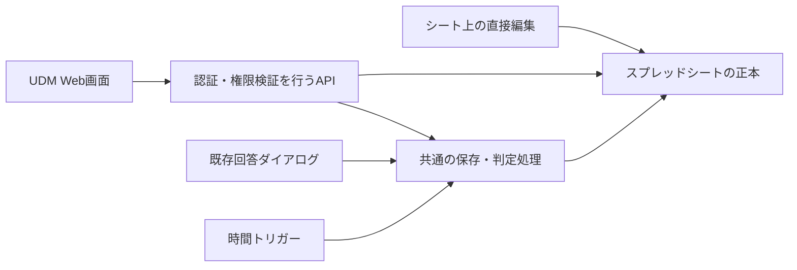

# シートを正本とするバックエンド設計（たたき台）

本番用API・Next.js画面・Git管理と自動反映のコードは作成済み。
現在の確認範囲と未実施項目は [実装状況](afetiria-extra-implementation.md) を参照。

## 構成

2026-11-19 のユーザー要望により、Firestoreへの回答移行案を置き換える。
スプレッドシートを主なデータベースとし、バックエンドが業務ルールを含む入出力を担う。
画面はUDMのNext.js、認証はFirebase Authentication、バックエンド候補はApps Script。
回答データをFirestoreに複製しない。Firebaseは認証に利用する案。

Web側で保存すれば同じシートが更新され、シート側の変更はWebの再取得で反映される。
別々のDB同士の同期・競合解決を新設しない。
画面の即時プッシュ反映は未確定。初期案は手動再取得・画面復帰時・表示中の低頻度ポーリング。
ポーリング間隔とキャッシュTTLは利用人数・速度・実行枠を計測して決める。
非表示タブでは停止し、未保存の下書きを取得結果で上書きしない。

## 正本と公開範囲

回答の正本は既存の「（管理者用）回答管理」。
「日程調整」「開催日程」は、設定と回答を参照する表示・集計欄。
Webの読み取りでは同じ設定と回答を読み、集計関数と数式の結果の一致を確認する。
最低人数・上限・更新猶予は一つの設定に統一し、現行の固定値との差を解消する。
メンバー ID は名前対応表と関連付け、行・列の位置だけで名前を紐付けない。
IDを置く列を決める前に既存の数式・名前変更・並べ替えへの影響を確認する。
スプレッドシートを公開閲覧や「ウェブに公開」にしてAPIの代用にしない。

## バックエンドの責務

- Firebaseの認証トークンを信頼できる方法で検証し、対象サービスの許可を確認する。
- クライアントから送られたUID・roleだけを信じて認証しない。
- 一般参加者は回答変更、管理者はメンバー追加・必須設定・候補管理・開催確定を実行できる。
- 権限設定はバックエンド側の保護された設定に置く。実UIDを公開コードに固定しない。
- 週ID・メンバーID・候補・回答値・更新可能項目を毎回検証する。
- 設定・人数判定・差分保存・週更新の処理を、既存ダイアログとWebで共用する。
- 任意のシートID・範囲を指定する汎用読み書きAPIは公開しない。
- ログやAPIエラーへトークン・パスワード・回答一式を出力しない。

## 操作契約の案

| 操作 | 権限 | 入力と結果 |
| --- | --- | --- |
| 回答画面の取得 | 参加者・管理者 | 現在週、ID付きメンバー、候補、回答、判定 |
| 回答保存 | 参加者・管理者 | 週ID・メンバーID・変更日時と回答。保存結果を返す |
| メンバー追加・必須設定 | 管理者 | IDを保持して設定変更、候補を再集計 |
| 候補追加・削除 | 管理者 | 対象週と日時。回答済み候補の削除は禁止する案 |
| 開催確定 | 管理者 | 開催可能な候補か再検証し、選択日時を保存 |
| 履歴取得 | 参加者・管理者 | 指定週の履歴を取得。取得範囲を制限する |

保存は変更日時だけを反映し、表示時点の回答一式を丸ごと書き戻さない。
保存時に最新値と表示時点の値を比較し、同じ回答箇所が変わっていたら再確認を求める案。
バージョン情報と冪等キーは二重保存・古い週への保存防止に利用する案。

## 変更の検知

シートの手動編集は onEdit 系処理でキャッシュを破棄する。
Apps ScriptやAPIによる書き込みでは編集トリガーが発火しないため、
既存ダイアログ・Web保存・候補変更・週更新の各成功処理で明示的にキャッシュを破棄する。
数式の再計算だけを編集トリガーで検出できるとは扱わない。
元の90秒キャッシュをそのまま使うと表示が古くなるため、反映遅延の要件に合わせて調整する。

## 排他制御と直接編集

Apps Script Webアプリ実行ではgetDocumentLockがnullになり得る。
Web入口と既存ダイアログ・定期処理を同じスクリプトにまとめ、getScriptLock等の共通ロックを使う案。
現行のgetDocumentLockだけを前提に、そのままWeb APIとして公開しない。

スクリプトのロックは、人がセルを直接編集する操作を止めない。
読み取り・検証・保存の間の手動編集も含めた完全なトランザクションは保証しない。
構造変更・メンバー追加・必須設定は管理者画面を通常の操作経路とする。
シートを引き続き編集する場合の保護範囲・同時編集・最終優先ルールは運用要件として残す。
同一batchUpdate内の更新は原子的に適用できるが、先行する読み取りとの間の競合は別問題。

## 週更新

1系統の時間トリガーでシートを更新し、Webもその結果を読み取る。
開催確定週は開催2時間後、未確定のまま終わった週は未開催として自動更新する。
未開催の期限は翌月曜0時以降、確定週は開催2時間後を優先する案。
候補は手動追加分も含めて7日進め、履歴保存後に新しい週の回答を未回答にする。
履歴作成・週状態・更新処理IDを使い、中断と再実行による二重繰り越しや回答消失を防ぐ。
読み書きの途中状態をAPIが完成データとして返さないよう、更新状態を共通処理で検証する。
現行コードの履歴保存後の未完了マーカーは、中断位置を含めて再設計する。

## UDM共通URL短縮

URLと転送先の対応表もシートに保存する案。日程調整の回答とは別の管理用ブックを候補とする。
作成・変更はUDM共通の管理権限で検証し、解決APIでは公開してよい転送先だけを返す。
利用者情報や認証情報を短縮URLに含めず、転送先で認証する。
短縮URLの仕様自体は [共通設計](shared-url-shortening-design.md) を参照。

## 実証が必要な項目

- GitHub PagesからApps Scriptへ認証付きで読み書きする通信方式。
- ContentServiceのリダイレクト、CORS、成功・失敗レスポンスの取得。
- Firebaseトークンの検証方法とサービス別権限の保持・失効。
- シート編集者へのGoogle権限要求を参加者に課さずに利用できること。
- Web実行時のロック・キャッシュ・PropertiesServiceのスコープ。
- 読み取り時間、再計算の反映、通信回数、同時実行と無料実行枠。

[通信検証の結果](sheets-transport-verification.md) にローカル17件と実ブラウザー試験9項目の結果を記録した。
Google環境での実接続・Firebaseの実認証・無料枠の実測は未完了であり、その確認後にAPI方式を確定する。
no-corsで保存結果が読めないまま成功扱いにしたり、認証情報をURLへ入れたりしない。
接続検証は匿名のテストデータで行い、本番シートの構造や既存トリガーを先に変更しない。

## 参考

- Web apps: https://developers.google.com/apps-script/guides/web
- ContentService: https://developers.google.com/apps-script/guides/content
- Trigger restrictions: https://developers.google.com/apps-script/guides/triggers/installable
- LockService: https://developers.google.com/apps-script/reference/lock/lock-service
- Sheets batchUpdate: https://developers.google.com/workspace/sheets/api/guides/batch
